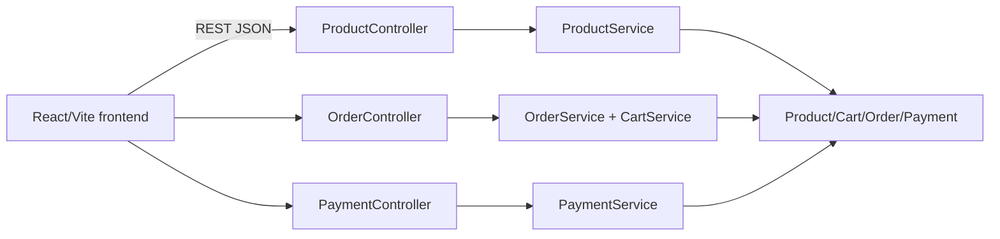

# loja-virtual-completa

**English** · [Português (Brasil)](README.md)

    

## What it is

**A complete online store** (fullstack): a **Spring Boot REST API** covering the e-commerce flow — **products**, **cart**, **order checkout** and **payments** — plus a **React + TypeScript + Vite web UI**. An explicit domain model (`Product`, `Cart`, `CartItem`, `Order`, `OrderItem`, `Payment`) and status enums.

## Status

A working fullstack app (prototype/lab). API tests passing (29 tests).

## Features

- **Products** (`ProductController`): `GET/GET{id}/POST /produtos`, `PUT /produtos/{id}/estoque`, `DELETE /produtos/{id}`.
- **Cart** (`CartService`): adds items and validates quantity > 0; `Cart`/`CartItem` in the domain.
- **Orders** (`OrderController`): `POST /pedidos/checkout` — validates a non-empty cart and available stock; `GET /pedidos`, `GET /pedidos/{id}`.
- **Payments** (`PaymentController`): `POST /pagamentos` — validates a value > 0 and **equal to the order total**; `GET /pagamentos/{id}`.
- **Methods and status**: `PaymentMethod` (CARTAO_CREDITO, PIX) and status enums for `Order` (RECEBIDO, PAGO, ENVIADO, ENTREGUE, CANCELADO) and `Payment` (PENDENTE, APROVADO, RECUSADO).
- **React frontend** (Vite) that consumes the API.

## Architecture

A **Spring Boot 3** backend with controller → service layers over **in-memory repositories** (`InMemory*Repository` with `ConcurrentHashMap`, no external database), with its own exceptions (`BusinessException`, `ResourceNotFoundException`). A **React + Vite** frontend in `frontend/`.



## Stack

- Backend: Java 21, Spring Boot 3 (Web), Maven — **in-memory** storage (repositories with `ConcurrentHashMap`, no JPA/external database)
- Frontend: React 18, TypeScript, Vite

## Repository layout

```
loja-virtual-completa/
├── pom.xml · src/                # Spring Boot backend
│   └── main/java/com/lojavirtual/
│       ├── controller/ · service/
│       ├── domain/ (Product, Cart, Order, Payment + enums)
│       ├── dto/ · exception/ · repository/
│       └── LojaVirtualApplication.java
├── frontend/                     # React + Vite UI
└── README.md
```

## Prerequisites and installation

- JDK 21 and Maven 3.9+ (backend)
- Node.js ≥ 18 (frontend)

```bash
# backend (API at http://localhost:8080)
mvn spring-boot:run

# frontend
cd frontend && npm install && npm run dev
```

## How to run

```bash
# create a product
curl -X POST http://localhost:8080/produtos -H "Content-Type: application/json" \
  -d '{"nome":"Keyboard","preco":150,"estoque":10}'

# checkout
curl -X POST http://localhost:8080/pedidos/checkout
```

## Tests and quality

Real command (verified by the agent):

```bash
mvn test
# BUILD SUCCESS — 29 tests passing (0 failures, 0 errors)
```

## Technical decisions and trade-offs

- **Explicit domain model** (Product/Cart/Order/Payment): a clear e-commerce flow with status enums.
- **Service validations** (quantity, stock, payment value = total): testable business rules.
- **Separate frontend** (React/Vite): decouples the UI from the API.

## Known limitations and roadmap

- No authentication; simulated payment (no real gateway integration).
- **In-memory** storage (`ConcurrentHashMap` repositories): data is lost on restart.

## Development process

An individual project by Kelvin Oliveira, built with orchestrated AI agents and reviewed by the author. The domain modelling, the rules and the review are the author's.

## License and author

MIT — Copyright (c) 2026 Kelvin Rebelo de Oliveira.

**Author**: [Kelvin Oliveira](https://github.com/KelvinOliveiraCode) · [Portfolio](https://kelvinoliveiracode.github.io/portfolio/)
