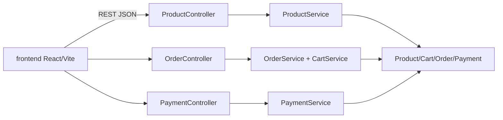

# loja-virtual-completa

[English](README.en.md) · **Português (Brasil)**

    

## O que é

**Loja virtual completa** (fullstack): uma **API REST em Spring Boot** com o fluxo de e-commerce — **produtos**, **carrinho**, **checkout de pedidos** e **pagamentos** — mais uma **interface web em React + TypeScript + Vite**. Modelo de domínio explícito (`Product`, `Cart`, `CartItem`, `Order`, `OrderItem`, `Payment`) e enums de status.

## Status

Aplicação fullstack funcional (protótipo/laboratório). Testes da API passando (29 testes).

## Funcionalidades

- **Produtos** (`ProductController`): `GET/GET{id}/POST /produtos`, `PUT /produtos/{id}/estoque`, `DELETE /produtos/{id}`.
- **Carrinho** (`CartService`): adiciona itens e valida quantidade > 0; `Cart`/`CartItem` no domínio.
- **Pedidos** (`OrderController`): `POST /pedidos/checkout` — valida carrinho não vazio e estoque disponível; `GET /pedidos`, `GET /pedidos/{id}`.
- **Pagamentos** (`PaymentController`): `POST /pagamentos` — valida valor > 0 e **igual ao total do pedido**; `GET /pagamentos/{id}`.
- **Métodos e status**: `PaymentMethod` (CARTAO_CREDITO, PIX) e status `Pedido` (RECEBIDO, PAGO, ENVIADO, ENTREGUE, CANCELADO) e `Pagamento` (PENDENTE, APROVADO, RECUSADO).
- **Frontend** em React (Vite) que consome a API.

## Arquitetura

Backend em **Spring Boot 3** com camadas controller → service sobre repositórios **in-memory** (`InMemory*Repository` com `ConcurrentHashMap`, sem banco externo), com exceções próprias (`BusinessException`, `ResourceNotFoundException`). Frontend **React + Vite** em `frontend/`.



## Stack

- Backend: Java 21, Spring Boot 3 (Web), Maven — armazenamento **in-memory** (repositórios com `ConcurrentHashMap`, sem JPA/banco externo)
- Frontend: React 18, TypeScript, Vite

## Estrutura do repositório

```
loja-virtual-completa/
├── pom.xml · src/                # backend Spring Boot
│   └── main/java/com/lojavirtual/
│       ├── controller/ · service/
│       ├── domain/ (Product, Cart, Order, Payment + enums)
│       ├── dto/ · exception/ · repository/
│       └── LojaVirtualApplication.java
├── frontend/                     # UI React + Vite
└── README.md
```

## Pré-requisitos e instalação

- JDK 21 e Maven 3.9+ (backend)
- Node.js ≥ 18 (frontend)

```bash
# backend (API em http://localhost:8080)
mvn spring-boot:run

# frontend
cd frontend && npm install && npm run dev
```

## Como executar

```bash
# criar produto
curl -X POST http://localhost:8080/produtos -H "Content-Type: application/json" \
  -d '{"nome":"Teclado","preco":150,"estoque":10}'

# checkout
curl -X POST http://localhost:8080/pedidos/checkout
```

## Testes e qualidade

Comando real (verificado pelo agente):

```bash
mvn test
# BUILD SUCCESS — 29 testes passando (0 falhas, 0 erros)
```

## Decisões técnicas e trade-offs

- **Modelo de domínio explícito** (Product/Cart/Order/Payment): fluxo claro de e-commerce, com enums de status.
- **Validações no service** (quantidade, estoque, valor do pagamento = total): regras de negócio testáveis.
- **Frontend separado** (React/Vite): desacopla UI da API.

## Limitações conhecidas e roadmap

- Sem autenticação; pagamento simulado (não integra gateway real).
- Armazenamento **in-memory** (repositórios `ConcurrentHashMap`): os dados se perdem ao reiniciar a aplicação.

## Processo de desenvolvimento

Projeto individual de Kelvin Oliveira, construído com agentes de IA orquestrados e revisado pelo autor. A modelagem de domínio, as regras e a revisão são do autor.

## Licença e autor

MIT — Copyright (c) 2026 Kelvin Rebelo de Oliveira.

**Autor**: [Kelvin Oliveira](https://github.com/KelvinOliveiraCode) · [Portfólio](https://kelvinoliveiracode.github.io/portfolio/)
